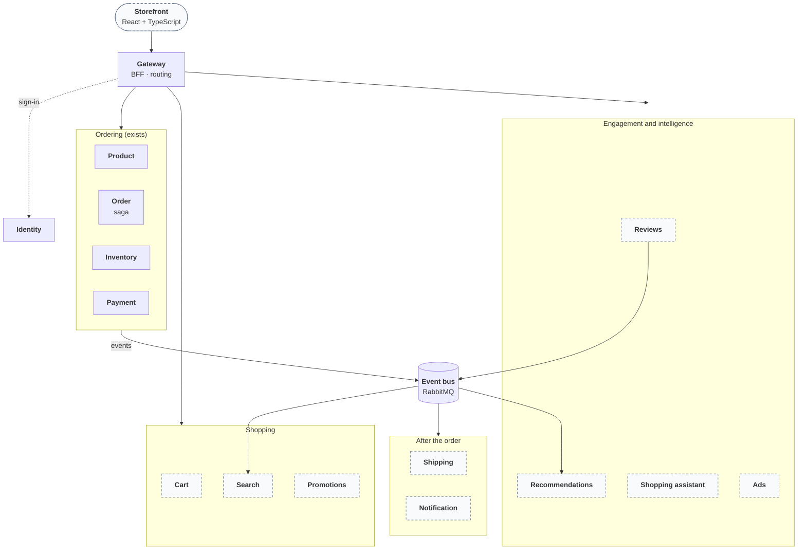

# ShopEasy roadmap

Where the project is going, and why each piece is in it. The current state, its guarantees and its
known gaps are in the [README](../README.md); this document is about direction.

## Purpose

ShopEasy is an online store in the spirit of Amazon or Digikala, built to work through the problems
of **production-grade microservices**: services that own their data, talk through events and APIs,
survive failures, are secured, observed, tested against real infrastructure and deployed from a
pipeline.

It is not meant to be deployed live. That makes direction more important, not less: every service on
this page is here because it forces a real distributed-systems problem that a smaller system would
let us avoid, and a service that brings no new problem does not get built.

## Where it stands

Six services (Gateway, Identity, Product, Inventory, Order, Payment) process an order correctly under
failure: a saga with compensation, transactional outbox and inbox, idempotent consumers and API,
resilient calls, per-API authorization, observability, CI/CD and Kubernetes manifests. What is
missing is everything a shopper sees or expects around the order: no storefront, no cart, no search,
no shipping, no notifications, payments are simulated, and there is nothing that engages or advises
the customer. The README lists the [known limitations](../README.md#production-hardening-roadmap--known-limitations).

## Target architecture

Solid boxes exist today, dashed boxes are planned.

The event bus stays RabbitMQ for commands and the order saga. Whether the high-volume event streams
(views, clicks, purchases for recommendations and ads) belong on Kafka instead is decided when the
first of them is built, see [open decisions](#decisions).

## Stages

The order is by dependency and by how soon a shopper meets the piece, not by size. Each stage ends with a system that
works and is documented.

### A shop you can use

| Piece | What it adds | The problem it brings |
|---|---|---|
| **Storefront** (React + TypeScript, served behind the gateway) | Browse, cart, checkout, orders, sign-in and sign-up; administrators get catalog, stock and account screens | The Backend-for-Frontend in practice: cookie session, no tokens in the browser, API composition, error and loading states for a system that is eventually consistent |
| **Cart** (Redis) | A cart that survives page loads, merges a guest cart into the user's at sign-in, and is checked against current prices and stock at checkout | Short-lived state with a TTL, concurrency on a hot key, why checkout re-prices instead of trusting the cart |
| **Search** (OpenSearch) | Full-text search, filters and facets over the catalog | A CQRS read model fed by Product events, eventual consistency, reindexing without downtime |
| **Notification** (Mailpit locally) | Order confirmation and status e-mail, and a self-service password reset | An event consumer with templates, retries and idempotence; the e-mail sender the account flows have been missing |

### Getting the order to the customer

| Piece | What it adds | The problem it brings |
|---|---|---|
| **Shipping** | Shipment created when an order is paid, tracking states from packed to delivered, carrier updates by webhook | A fourth participant in the order saga, a state machine, an adapter that keeps a carrier's model out of ours, inbound webhooks |
| **Payment providers** | A real sandbox gateway behind the simulated one; cancel and refund after payment, and the `Failed` saga leaving the order `Pending` closed | Adapters behind one port, webhooks, compensation after the money has moved |
| **Promotions and coupons** | Discount rules and limited-use coupons applied server-side | Pricing rules as a service, redemption under concurrency |

### Engagement

| Piece | What it adds | The problem it brings |
|---|---|---|
| **Reviews and ratings** (document store) | Reviews of products the user bought, rating aggregates on the product page and in search | Polyglot persistence, a "verified purchase" derived from order events, aggregates flowing back into other read models |
| **Recommendations** | "Bought together" and "viewed together" from the event stream, later embeddings | Stream processing, a batch and a live path, cold start |

### Intelligence and revenue

| Piece | What it adds | The problem it brings |
|---|---|---|
| **Shopping assistant** | Chat that finds products and answers order questions by calling the existing APIs with the signed-in user's own token | Tool calling with authorization carried through, retrieval over the catalog, guardrails, rate and cost limits, testing a non-deterministic component |
| **Ads** | Sponsored placements ranked into search and category pages, impression and click tracking, budgets | High-volume event ingestion, ranking, pacing against a budget. The hardest piece, so it comes last |

### Platform maturity

Cross-cutting work that pays off once there are many services: contract tests between services, an
end-to-end order test in CI, load tests, autoscaling on queue depth, TLS between services, per-API
tokens instead of one token naming every API, replicated data stores in Kubernetes, and a
deployment pipeline (GitOps) instead of a hand-bumped image tag.

## What every service must meet

A new service is finished when it has what the existing ones have, not when it runs:

- its own database or store, and no reads into another service's data;
- events published through the outbox, consumed idempotently;
- authentication and per-API audience, scope and role checks;
- health probes, metrics, structured logs and traces with the correlation id;
- tests against real PostgreSQL and RabbitMQ where behaviour depends on them;
- an unprivileged, read-only container, Kubernetes manifests with a network policy, and a CI job;
- every setting visible in `appsettings.json`, Compose, `.env.example` and the Kubernetes ConfigMap;
- a section in the README that says what it does, how to use it and what it does not do.

Work arrives as small pull requests, one concern each, so that each can be reviewed in full.

## Decisions

**Taken**

- The storefront is a React and TypeScript single-page application served behind the gateway, which
  stays the only entry point and keeps the session in a cookie.
- Cart and search come before shipping and recommendations, because they are what a shopper meets first.

**Open**

- *Language of the storefront:* English only, or Persian with right-to-left layout from the start.
  Cheaper to decide before the first screen than after.
- *Event streaming:* keep everything on RabbitMQ, or introduce Kafka for the high-volume streams when
  recommendations are built.
- *Shopping assistant model:* a hosted model behind an API key (cost, and a secret to manage) or a
  local one. Either way it sits behind an interface with a fake implementation for tests and CI.
- *Payment sandbox:* which provider's sandbox the adapter targets first.

**Deferred**

- *Several sellers per product*, as Digikala has. It changes the catalog, pricing, stock and orders
  together, so it is a large step of its own, taken after the single-seller flow works end to end.
- *Wallet and loyalty points* (a double-entry ledger) and *returns*.

## Not goals

Real payments or real customer data, claims about throughput at scale, and a visual design contest.
The storefront is there so that the services are used, and it is built to be plain and correct.
