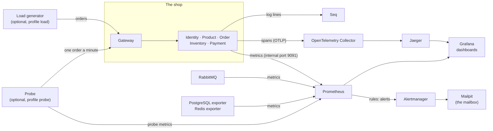

# Observability: the team guide

For a developer who has never seen the project. It says what the observability stack is for, which tool answers which question, how to follow one order through all of it, and how to be looking at a working alert fifteen minutes after you cloned the repository. The details are in the [main README](../../README.md); this guide is the map, and each section says where the detail is.

## What it is for

ShopEasy is built to survive failures: a retry that works, a saga that compensates, an outbox that waits for the broker. A retry that works is **invisible** without observability, and one that does not work must **wake somebody**. So the stack has one job: make the failures the reliability patterns are meant to survive **visible, explainable and alarming**. The rest of this guide answers three questions:

1. **What can fail?** See [What happens when a part fails](../../README.md#what-happens-when-a-part-fails).
2. **How do we see it, and how are we told?** Metrics, dashboards and alerts (below).
3. **How do we find the cause?** Logs and traces joined by one id (below).

## The stack in one picture



Three signals about the same system: **logs** (what happened, in words), **traces** (what called what, and how long each step took), **metrics** (how much, how often, how long, over time). One **correlation id** and one **trace id** run through all of them, so you can go from any one to the others. The services only know where to send things (`Telemetry__Endpoint`, the Seq address); what happens next is the configuration of the Collector, Prometheus and Alertmanager.

## Which tool answers which question

| Your question | Go to | Start with |
|---|---|---|
| Is the shop healthy? Something wrong? | Grafana, **ShopEasy Overview** (http://localhost:3000) | The landing page: traffic, errors, p95, order outcomes, stuck orders |
| Which service? | Grafana, **ShopEasy Service Health** | The service and instance variables; up, errors, latency, load |
| Where in the life of an order? | Grafana, **ShopEasy Order Flow**, and the **Saga Monitor** (http://localhost:5000/sagas, as an administrator) | The funnel placed → stock reserved → paid → confirmed |
| Which dependency? | Grafana, **ShopEasy Dependencies** | RabbitMQ queues, PostgreSQL connections, Redis |
| Can a customer buy right now? | Grafana, **ShopEasy Synthetic Orders** (empty unless the [probe](../../README.md#a-synthetic-order-every-minute) runs) | The five steps of the last run |
| What happened to *this* order? | Seq (http://localhost:5341), Jaeger (http://localhost:16686), the Saga Monitor timeline | `OrderId = '<guid>'` in Seq; tag `order.id=<guid>` in Jaeger |
| Why was *this* request slow? | Grafana's latency graph → an exemplar → Jaeger → Seq | [From a slow request to its trace and its logs](../../README.md#from-a-slow-request-to-its-trace-and-its-logs) |
| Who tells me when it breaks? | Prometheus alerts (http://localhost:9090/alerts) → Alertmanager (http://localhost:9093) → the mail in Mailpit (http://localhost:8025) | The `Watchdog` mail: proof that alerts can reach you |
| A message failed all its retries | The **Dead Letter Monitor** (http://localhost:5000/deadletters, as an administrator) and the alert `DeadLettersPresent` | [Working with dead letters](../../README.md#working-with-dead-letters) |

The full list of tools, URLs and logins is the table in [Developer Portal & Monitoring](../../README.md#developer-portal--monitoring); the same links are on the portal page, http://localhost:5000/portal.

## Follow one order through logs, traces and metrics

1. **Place an order** in the storefront (http://localhost:5000). The address of its order page ends in the order id: `/orders/<guid>`. (The Saga Monitor lists orders with their ids too.) The id of the whole request is the `X-Correlation-Id` response header, visible in the browser's network tab or with `curl -i`.
2. **Seq:** search `OrderId = '<guid>'`. You see the gateway request, each saga step in the Order service, the stock reserved in Inventory, the payment in Payment, in order. `CorrelationId = '<id>'` finds the same story from the request.
3. **Jaeger:** search the tag `order.id=<guid>`. An order is *one trace*: the request, the outbox delivery, the saga and every message down to the confirmation. Each log line also carries its `TraceId`, so Seq and Jaeger lead to each other.
4. **Saga Monitor:** http://localhost:5000/sagas has, per order, a timeline of every status it passed and how long it stayed in each.
5. **Metrics:** on **ShopEasy Order Flow** the same order is one step of the funnel and one sample of the "time in each saga step" panel.

The details, including what to do when a trace is not there (not sampled), are in [Following one order across services](../../README.md#following-one-order-across-services) and [Traces](../../README.md#traces).

## How an alert reaches you, and what to do

Prometheus evaluates [`prometheus-rules.yml`](../../prometheus-rules.yml) every 15 seconds. An alert that stays true for its `for:` time **fires**; Alertmanager groups it and mails it to Mailpit, with a link to its **runbook** in the README. Each runbook says what the alert **means**, where to **look** first and what to **do**. Two severities, as [`alertmanager.yml`](../../alertmanager.yml) treats them: **critical** needs a person now (mailed within seconds, repeated every hour); **warning** is grouped and repeated every four hours. While a known cause fires (`ServiceDown`, `DependencyDown`), the symptoms it explains are not mailed ([How alerts reach you](../../README.md#how-alerts-reach-you)). `Watchdog` always fires, on purpose: if its mail stops arriving, alerts are not being delivered.

## Your first fifteen minutes

```bash
git clone <your-repo-url> && cd ShopEasy
cp .env.example .env     # replace every change-me-* value; set BOOTSTRAP_ADMIN_EMAIL and
                         # BOOTSTRAP_ADMIN_PASSWORD (without them nobody is an administrator)
docker compose up -d --build     # the shop and every tool; the first build takes a few minutes
```

1. Open **Mailpit** (http://localhost:8025): the `Watchdog` mail is there within a minute or two. Alerting works.
2. `ops/demo/load.sh --rate 20 --duration 900` places orders (confirmed, declined by the payment provider, cancelled); the first run also builds the small load-generator image. Open **Grafana** (http://localhost:3000, user `admin`, password `GRAFANA_ADMIN_PASSWORD` from `.env`): Overview and Order Flow move.
3. `ops/demo/break.sh payment` stops Payment and prints what to expect. Watch http://localhost:9090/alerts: `ServiceDown` goes pending, then firing after a minute; its mail arrives. On Order Flow, orders stop at "stock reserved".
4. Find one of those orders in Seq and Jaeger (the section above): its trace stops after the stock reservation. That is the explanation.
5. `ops/demo/fix.sh payment`. The alerts resolve and the waiting payments are processed.

The other five failures are in [scenarios.md](scenarios.md), which is also the demo script of the presentation ([presentation.md](presentation.md)). The README's [Traffic and failures to try](../../README.md#traffic-and-failures-to-try) describes the scripts themselves.

## Where things are in the repository

| What | File |
|---|---|
| What Prometheus scrapes | [`prometheus.yml`](../../prometheus.yml) |
| The alerts and their tests | [`prometheus-rules.yml`](../../prometheus-rules.yml), [`prometheus-rules.test.yml`](../../prometheus-rules.test.yml) |
| Where the alerts go | [`alertmanager.yml`](../../alertmanager.yml) |
| The dashboards (code) | [`grafana/provisioning/`](../../grafana/provisioning) |
| Where spans go | [`otel-collector.yml`](../../otel-collector.yml), [`jaeger/ui.json`](../../jaeger/ui.json) |
| The probe and the load generator | [`src/Tools/ShopEasy.Probe`](../../src/Tools/ShopEasy.Probe), [`src/Tools/ShopEasy.LoadGen`](../../src/Tools/ShopEasy.LoadGen) |
| The demo scripts | [`ops/demo/`](../../ops/demo) |
| What CI proves about all of it | [`.github/scripts/`](../../.github/scripts) (`check-metrics.sh`, `check-grafana.sh`, `check-dashboards.py`, `check-traces.py`, `check-probe.sh`, ...) |

## What it does not do

- Alerts are **mails to a local mailbox**; no pager or chat is wired up (add a receiver in `alertmanager.yml`).
- The **Kubernetes** manifests ship none of this stack.
- **Governance** was left out: log retention, personal data in logs and an audit log have not been worked on.
- The **probe** and the **load generator** are off unless asked for (Compose profiles `probe` and `load`).
- On a fresh start the dashboards are empty until orders flow, and an alert fires only after its own `for:` time (a minute for `ServiceDown`, several for the others).
